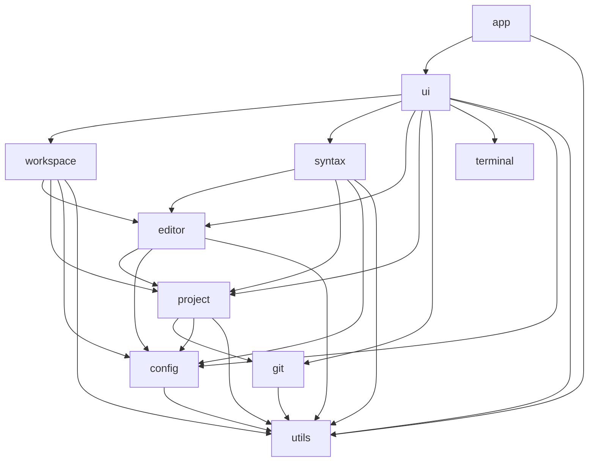

# Architecture and source map

Orlo is a Cargo workspace with ten crates. `orlo-app` builds the `Orlo` executable and is the
default workspace member. The other crates own the models and services used by the GPUI
application. Cargo checks these boundaries: a backend cannot reach a UI implementation through
an internal module path.

## Crate ownership

| Crate | Responsibility | Main source folders |
| --- | --- | --- |
| `app` | Process entry point and application bootstrap | `crates/app/src/` |
| `editor` | Text buffers, selections, cursor motion, undo, editing commands and search models | `buffer/`, `cursor/`, `selection/`, `history/`, `commands/`, `search/`, `viewport/` |
| `workspace` | Pane, tab and layout state, session persistence and launch navigation | `panes/`, `tabs/`, `layout/`, `sessions/`, `navigation/` |
| `project` | Project roots, explorer data, filesystem operations, document storage and disk watching | `directories/`, `explorer/`, `paths/`, `filesystem/`, `documents/`, `watchers/` |
| `git` | Repository status, file and partial staging, commit composition/amend, stashes, branches, local tags, worktree lifecycle, explicit remote/upstream controls, file history, blame, diffs and conflicts | `repository/`, `status/`, `staging/`, `commits/`, `stashes/`, `branches/`, `tags/`, `worktrees/`, `remotes/`, `history/`, `blame/`, `diff/`, `operations/`, `errors/` |
| `terminal` | PTY sessions, shell input, process lifecycle and terminal emulation | `pty/`, `sessions/`, `shell/`, `input/`, `output/`, `processes/`, `emulation/`, `configuration/` |
| `ui` | GPUI views, windows, widgets, panels, menus, native UI integration and feature orchestration | `crates/ui/src/` |
| `syntax` | Highlighting, bundled parsers, the language registry, completion, spelling and language-server transport | `highlighting/`, `grammars/`, `languages/`, `detection/` |
| `config` | Settings, scope selectors, EditorConfig, keymap data, themes and automation configuration | `settings/`, `keybindings/`, `themes/`, `persistence/` |
| `utils` | Shared paths, text algorithms, fuzzy matching and native helpers | `paths/`, `text/`, `fuzzy/`, `objc.rs`, `directory.rs` |

Folder paths in the last column are relative to each crate's `src/` unless otherwise stated.
The package names are `orlo-app`, `orlo-editor`, and so on; Rust imports use underscores, such
as `orlo_editor::text::EditorState`.

## Dependency direction

The application starts the UI. The UI composes workspace state, editor models and backends.
Workspace and syntax services can use editor and project models; those models do not depend on
the UI. Configuration and shared helpers sit below them. Git and terminal operations have no
dependency on GPUI views.



An arrow means “depends on.” Each crate's `Cargo.toml` is the source of truth for its direct
dependencies. GPUI color and configuration value types can appear below `ui`; GPUI views,
entities, subscriptions and window orchestration stay in `ui`.

The boundaries follow the data's owner. File encodings, atomic writes, history snapshots and
file stamps belong to `project`. Editor state calls those storage APIs when loading or saving.
Session and project-workspace files belong to `workspace`, which can serialize editor state
without making project data depend on a window. Parser symbol results and documentation state
belong to `syntax`; the GPUI project index that subscribes to views and schedules work belongs
to `ui`.

Symbol parsing memoizes exact line/parser-state transitions with 256 states, at most 16,384
entries and a 4 MiB retained payload. The existing 1,024-byte line admission bound permits
compact offset/operation-index pairs; at most 1,024 exact scope operations are interned and
charged to that same payload budget. Complete admission publishes catalog additions together
with the transition. An unrepresentable operation or exhausted budget uses ordinary parsing;
state guards, oversized-capture shutdown, cancellation and checkpoints keep their existing policy.

Snippet expansion remains in the editor model. Scope matching is supplied by its caller, so
the model does not need to depend on the highlighter that consumes editor changes. Settings
own serialized language-server configuration, and config owns asset discovery shared by themes
and highlighting, including the list of user language folders. Syntax reads those folders: the
language manifest (`languages/manifest.rs`) and the registry that loads, overrides and detects
languages (`languages/registry.rs`). These seams keep the dependency graph acyclic without
moving feature models into `utils`.

Date/time formatting lives in utils/date_time and uses the existing SystemTime/libc native
conversion seam with an exact directive whitelist, without a new dependency or subprocess.
UI captures time, clipboard and current index-root metadata only at actual local/LSP snippet
commit. One snapshot feeds the existing model resolver across carets; model-owned per-caret
variables keep priority. Index roots are installed synchronously independently of background
index readiness. The date/time form and recordable editor action reuse document/view mutation,
shared composition admission and ordinary Undo; stale form targets refuse before insertion.

Workspace's New From Template picker reads all local snippets and then the existing language
catalog. Confirmation rereads the local definition through editor's snippet owner, rejects
stale contents/language IDs and admits shared composition before moving focus. A new editor
expands with ordinary fields/variables before attachment; forgotten saved-point metadata makes
even an empty expansion dirty. Saving keeps the ordinary untitled Save As route. Highlighter
manual choices can retain a runtime registry ID independently of a missing grammar's Plain Text
fallback; the same ID supplies scoped preferences and language service routing.

Numeric choice fields share the local/LSP snippet parser and existing per-view field session.
Expanded primaries retain owned alternatives, including per-caret indentation; confirmation
uses ordinary range edits and mirror/transform synchronization in one Undo step. The editor
UI renders them in the existing anchored popup, keeping editor focus and field navigation.
Source/selection/IME/protected-input/view guards dismiss the list. Blur explicitly dismisses
hidden views; completion-provider cleanup leaves owned snippet choices alive.

Explicit shell filtering retains the config automation subprocess owner and UI action/form/
background-task owner. Editor `commands/filter` captures document/view/version/path and full
selection identity/generation; the legacy extension API remains single-input. Physical range
batches run serially with one deadline/output budget/cancel flag through the existing process
group kill/reap path. UI rechecks editable/shared-composition admission before atomic range
replacement or selection-history-only predicate retention. No keystroke or rendering path runs
shell commands, and source text reaches commands solely through STDIN.

Explicit terminal folder sync stays within terminal’s existing shell/session/PTY owners.
The UI selects the active file parent or first project root without launching or retargeting a
session. Any input invalidates readiness; integrated ZLE reports and a new command boundary
admit the next request. The PTY worker rechecks the actual foreground process group, writes
one bounded private request file and invokes a launch-local widget that checks live empty
BUFFER and queued keys. Shell-owner quoting keeps path bytes literal. Only real OSC7 reports
update cwd; its decoder permits percent-encoded control bytes only for the exact pending sync target,
while ordinary OSC7 and clickable URLs keep their stricter policy. Existing integration cleanup retains ownership through child reaping.

## Editing and presentation

`crates/editor/src/buffer/mod.rs` exports the shared buffer interface. Buffer state and edit
mapping stay under `buffer/`; cursor motion, selection operations and undo have separate
owners. Typing, line commands, snippets, bookmarks, column editing and transformations live
under `commands/`. Search state and matching live under `search/`; wrapping and display mapping
live under `viewport/`. Model regression tests stay under `buffer/tests/`.

`Document::edits_blocked()` admits source mutations centrally from the independent shared
Follow and user viewer flags. Viewer mode is transient and defaults off for every new document;
`set_viewer_mode` publishes a version-only change and ends typing coalescing while retaining text,
saved identity and Undo/Redo. Generic view editing still permits selection and navigation.
Workspace toggle admission checks native composition in every view of the actual document
entity, independent of same-path owners, before updating `OpenDocument`. Existing disk
`read_only` and immutable view input policies retain their separate meanings. Explicit saves
may serialize already dirty viewer text under the existing disk protections; save formatting,
cleanup and serialization-format policies skip protected mutations. Pending mutation results
revalidate document versions and every target before applying.


Passive selection occurrences are opt-in per-view derived state in UI's editor/occurrences.
They reuse editor/search's literal matcher, cancellation and background deadline while keeping
Find's cache and manual styles untouched. Document entity/rope/version, exact selection and its
generation plus request identity guard worker delivery. Painting reads prepared ranges and
clips them to visible non-fold source pieces; no text scan or geometry change occurs per frame.
Automatic queries admit at most 1,024 scalars before copying or scheduling; oversize selections
clear the overlay without a job. Existing Find limits remain with the search owner.

Inline diagnostics remain UI-derived state in editor/diagnostics. Existing epoch-guarded
language decoration publication prepares one winner per physical start line (severity, source
offset, then stable report order) and bounded preview text. The cache binds to the admitted
rope/version and existing language-service generation; duplicate views share it until their
source changes. Paint binary-searches winners at visible physical line ends, after the last
soft-wrap row, using trailing viewport width. It adds no rows, source text or pointer targets.
The existing diagnostics picker retains full admitted detail. Versionless server reports keep
the existing live-session admission policy; no server-internal compute version can be inferred.

### Display pipeline

A view turns buffer text into display rows in stages. Each maps positions both ways and
follows the edits of the stage below it:

```text
buffer text → folds (placeholders) → tabs → soft wrap → filler rows → viewport and pixels
```

| Stage | Owner | What it adds |
| --- | --- | --- |
| Folds | `rendering/fold.rs` (`Folds`), `rendering/folded.rs` (`DisplayText`, `Folded`) | Any char range hidden behind a three-column placeholder. A buffer line whose line break before it is hidden joins the display line above. |
| Tabs | `viewport/mod.rs` (`expand_tabs_at`, `col_after`, `char_at`) | Display columns: tabs run to their stops, counted from a display line's start. |
| Soft wrap | `viewport/mod.rs` (`WrapMap`) | Display lines broken into rows, placeholders laid out with their text and never cut. A display line's breaks live on its first buffer line; joined lines have no rows. |
| Filler rows | `viewport/filler.rs` (`Fillers`, `Padded`) | Rows with no text at line boundaries, sorted with running totals so each lookup is a binary search. |
| Viewport | `ui/src/views/editor/element.rs`, `mouse.rs` | Painting, clicks and scrolling, all through `Editor::rows()`. |

The `Rows` trait (`selection/mod.rs`) is the interface between the stages and the motion,
selection, painting and click code above them. Its coordinates are typed: `DisplayRow`,
`DisplayCol` and `DisplayPoint`. `row_bounds` is `None` for a filler row, which has no text;
`text_row` finds the nearest row that has text. With no folds and no fillers, `Folded` and
`Padded` short-circuit to the plain `Lines` or `WrapMap` paths. Building the stack costs
nothing per frame: folds keep their joined lines and running totals as they change, and filler
blocks are resolved lazily during each lookup.

Gutter numbering is a resolved config preference plus an optional window display choice.
Editor paint formats each existing first source-line row, using its own primary physical caret
line for relative distances; it never substitutes projected row indices or changes gutter width.
Wrap continuations, joined fold tails and filler rows keep their existing mapping and hit targets.

Cursor-column bands are an opt-in resolved view preference with the existing transient window
display override. Editor prepaint deduplicates selection-head x positions using the current
shaped rows and bounded long-line clip/tab expansion path, then crosses only visible text
rows beneath other backgrounds. Folded/WrapMap expose their existing metadata-only row
projection so offscreen caret lookup need not copy or expand a long source prefix. One caret
row's measurement is retained during traversal; filler rows, source bytes and hit targets are
untouched. No background job or persistent column geometry is added.

Folds and filler rows belong to a view, not to the document. They never change the text, its
undo history, saved bytes, search results, copied text or line numbers. `viewport/align.rs`
places filler rows for side-by-side diffs. It works from the hunks' line pairs and each side's
rows below its fillers, and it carries offsets across sides for matched folds. The UI's
`AlignedPair` (`ui/src/views/editor/aligned.rs`) applies it to two read-only views in Compare
Files and the Git panel.

Session `ViewState` stores optional versioned active-fold ranges with a SHA-256 fingerprint of
the decoded rope. Restore validates against the document actually attached to the view, including
shared text, before using the existing refold path. An editor-local immutable-rope cache avoids
rehashing unchanged session captures; paint never computes persistence fingerprints. The window
keeps bounded closed-view metadata through the same private session/workspace writer.

Unusual Unicode warnings are opt-in configurable scalar/range descriptions owned by `config/settings/unicode.rs`.
The editor paints their glyphs over existing shaped positions, visiting only clipped non-fold
`RowText` pieces and suppressing its active IME ranges. Character Info uses the same resolved
per-file maps and lookup: explicit scalars win, then greatest numeric range start/end. Ranges
are validated and compiled into disjoint lookup intervals without scalar enumeration; paint
binary-searches the compiled intervals. Warnings never change the display mapping, source text
or measurement pipeline.

Declarative modelines are parsed by `config/settings/modelines.rs` into optional supported
fields. Workspace preferences scan bounded rope edge lines, retaining a derived snapshot per
editor view to detect changed directives. Refresh applies indentation through the shared document
owner and display fields through view settings, above EditorConfig and below explicit choices.
Safe language names resolve through the existing syntax/registry catalog. The opt-in uses the
manual or ordinarily detected language; other scoped preferences use the declared language,
so declarations cannot oscillate their own enablement. The snapshot and declared language are
derived view data, never manual syntax or session metadata; no text is rewritten or evaluated.
LSP captures include derived provenance and the resolved catalog identity for stale checks.
Polling syncs only an already admitted matching derived document route; it closes obsolete
bindings while keeping siblings live. Same-server protocol changes defer the existing transport
reset until assistance admits the new route, preventing declaration-driven process startup.

Explicit discarded-untitled rescue is separate from session hot exit. Workspace's
`sessions/discarded.rs` owns bounded private text files and metadata-only retention, with
per-store capture generations serialized against Clear. UI's `workspace/discarded.rs` checks
confirmed discard and last-visible document ownership before the existing close continuations.
Capture finishes before the last window can quit; restore creates a dirty untitled document.
Retention keeps at most 50 rows younger than 30 days, with usable text at most 1 MiB per draft
and 8 MiB aggregate. Externally oversized private artifacts do not consume usable retention
count/bytes: valid records have priority, remaining row slots can show damaged artifacts for
explicit Delete, and invalid overflow is unlinked. External damage can exceed the usable-byte
bound on disk until deletion/expiry; capture never accepts oversized text. The Choices picker loads at most a 1 KiB search excerpt per record once
on a worker; keystrokes filter those derived keys without payload I/O. Its actions store a
generation and record ID. A dedicated dock reuses the read-only scratch editor for the selected
full preview and offers new-dirty-untitled restore, exact-record deletion and Clear. Worker
completions check loading-surface identity and a worker-issued atomic generation/revision/expiry
stamp. Metadata, permissions, membership, payload reads and pruning stay under the existing
Store lock on workers; foreground admission performs no filesystem work or storage-lock wait.
Serialized capture, Delete, Clear and pruning invalidate read stamps before mutation; only
Clear advances capture generation. Restore rereads storage rather than using viewer text. Delete shares the Store publication lock
without cancelling unrelated capture tickets; Clear advances the existing generation. Corrupt
text is localized to its row/preview and remains deletable; unsafe filesystem metadata fails
explicitly. Preview text in another window can remain visible after deletion, but its actions
cannot restore deleted records. Delayed Clear completion dismisses only its initiating rescue
picker/preview, preserving replacement/new-generation surfaces and their focus. Terminal read/
catalog failures keep a focused visible error picker with Browse/Return actions, independent
of status-bar visibility. No session schema contains rescue history. Actual tab/window close uses native unmark before
removing a composing view, so surviving views keep committed text; move-only removal preserves
the live view and its composition.

The UI's editor view renders this model and handles native input. Window orchestration manages
editor entities, focus, background reads and action routing; views of one document share it
rather than synchronize copies (see below).
Panels own their presentation while calling the corresponding model or backend crate.
Workspace state supplies pane geometry, tabs and recovery data independently of that rendering.

Explorer location history lives in each UI `SidebarState`, independently of editor jumps and
session persistence. Project's `explorer::Target` captures device/inode and kind on workers;
`LocationHistory` retains at most 32 total folder identities, branches on new visits, skips stale
Back/Forward targets and remaps known moves. Workspace's `explorer.rs` admits navigation using
request/source/project/focus/surface guards, then publishes into the existing listings/expanded/
row cache. Navigation never replaces project roots; Parent at an outer root refuses visibly.
Active-file ancestors and immediate children reuse the Choices picker and ordinary open/tree
reveal. Breadcrumb file opening carries its target/source/surface guard through the existing
opener and background loader, including large-file prompts. Guarded loads check device/inode on
the opened file handle and reject changed read stamps; busy leases refuse rather than queue an
unguarded path. Live dirty document ownership and ordinary missing-file/directory policies keep
their existing paths. Enumeration and identity validation stay on workers; rendering only builds cached tree
rows and the navigation controls. No source document edits, new tree engine or persistence are
involved.

Explorer filename ordering uses config's global `ExplorerSort` preference and project's
`explorer::sort_entries` on listing updates or preference changes. Natural ASCII digit runs
compare significant lengths/digits without integer conversion; folded filename keys are made
once per update. SidebarState retains cached parent row indices. Its optional sticky-ancestor
UniformList decoration uses current-frame scroll/viewport geometry and the shared real-row
renderer, with native pointer blocking that passes wheel events to the list. Logical row
indices stay unchanged; keyboard reveal reserves space for pinned ancestors. Neither setting
belongs to a document, file scope or session schema; lexical order and no pinned rows remain
the defaults.

Pattern line sorting remains an editor transformation used by the existing form and pipeline.
SortOpts validates explicit capture indices and comparator combinations before source edits;
line-block expansion, protected mutation admission, Undo and mixed-ending boundary metadata
remain with the existing editing owners. Natural sorting and explorer filenames share the exact
ASCII integer-chunk comparator in utils/text. Locale keys and a current-locale snapshot use
utils/collation through the existing Foundation/Objective-C seam; no broad collation dependency
or persistent setting is introduced. Grapheme length uses the existing segmentation dependency.

The editor action catalog in `ui/src/views/editor/actions.rs` supplies action declarations,
dispatch, macro recording and JSON reconstruction. `ui/src/views/workspace/command_entries.rs`
shares command families between native menus and the palette; each keeps its own presentation.

Syntax selection reads only the existing Tree-sitter State/Snapshot through Highlighter;
byte-to-character conversion uses the snapshot rope and refuses dirty/foreign trees. A parser
identity survives cloned highlight jobs and remains the receiver's during cache adoption, so
independently detected file-open warm trees remain reusable without reviving old selection history.
Background attachment can adopt partial warmup: named-range and fold queries may remain cold
until ordinary highlighting retries finish. Warmup retains the existing 10 ms parse slice and
cooperative urgent-work/cancellation policy; attachment does not certify parser readiness.
`ui/src/views/editor/syntax_selection.rs` owns the transient per-view reversal stack, tied to
document/text/parser identity, exact expected SelState and editor selection generation. Primitive
selection replacements and ordinary checkpoints/undo/redo advance that generation, including
workspace movements away and back without a frame. Cold queries queue existing highlight work
and ask for a retry, retaining no asynchronous selection result. No project AST index is involved.

Native spelling belongs to the syntax service's spelling worker. Native window, clipboard and
other application presentation integrations belong to UI platform code. The terminal and Git
crates provide their actual backends; their GPUI panels are in `ui`.

Git's `commits/mod.rs` owns subject/body/coauthor validation, message assembly and prepared
commit contexts. The shared `repository/target.rs` context pins canonical repository path,
root/Git-directory filesystem identity, symbolic HEAD and object ID; it is revalidated after asynchronous message loading
and immediately before running Git. `commit --file=-` consumes the message through stdin;
`--amend` is explicit. The existing `commit_draft` API keeps native author selection;
`commit_draft_as` accepts a validated optional `CommitAuthor` only for an explicit per-commit
author change. No identity, hook or signing configuration is overridden. Read-only native
`interpret-trailers --parse` first recognizes unmodified footer items, configured separators and aliases.
Suffix value markers map those same items back to original byte spans; their decoded result must
match the unmodified native parse. `stripspace --comment-lines` supplies Git's effective comment
prefix for scissors cutoffs; patch dividers also admit native ASCII whitespace. Marking and insertion
stay above these cutoffs; a trailing old-style `Conflicts:` block also remains unmarked, without
excluding a same-named footer item followed by ordinary prose. Only duplicate coauthor spans are removed, and validated canonical
coauthors are inserted within the footer or before an ignored tail. Unrelated
body/sign-off/folded text is never reserialized. Parsing runs no configured trailer commands;
assisted coauthors intentionally bypass `trailer.*` insertion/command rewriting. Commit hooks
remain available for policy, and Git still owns signing, hook execution and commit publication.
UI's `panels/git/commit.rs` owns the separate normal/amend actions, cancellable prefill,
project/repository guards and two window-local retained drafts (one per mode). Draft field
editors survive panel cancellation/failure; reopening copies their text into the new form.
Blank author override fields preserve configured ordinary authorship and the previous amend
author, including when a retained draft is reopened against a newer HEAD. Only the submitted
snapshot is committed; newer message or author field edits survive completion. Form inputs
reuse the existing editor's multiline-field mode and shared form keyboard handling. No Git
backend depends on GPUI, and no session schema stores these drafts.

Git's `stashes/mod.rs` owns prepared stash stacks (ordered selector/object-ID pairs), creation,
preview, apply/pop and drop. Each operation revalidates the shared repository identity and
stack; application uses the pinned object ID. Pop drops only after successful application,
retaining entries on conflicts. Deletion uses `git2::Transaction` to lock `refs/stash`, then
revalidates the prepared stack and matches the native reflog's ordered object IDs before
removing exactly the selected entry. Linked worktrees use libgit2's common-directory ref lock,
also honored by terminal Git. A push/drop before the lock causes stale refusal; while locked
normal Git ref writers cannot change that stack. Unsupported native repository formats are
checked before Pop applies; failure after application is reported separately from apply errors.
Preview drains bounded
stdout/stderr with external diff/textconv disabled and binary summaries. Only pathspec-free
`stash push` overrides literal-pathspec mode: Git internally uses `:/` for untracked cleanup,
which literal mode would suppress. All caller paths and the shared command environment stay
unchanged; there are no caller-supplied pathspecs in stash operations.

UI's `panels/git/stash.rs` owns the cancellable list/preview loading pickers, create form and
Drop confirmation. Action contexts include project generation/roots and prepared repository
state; completion preserves a replacement surface and file selection. Worktree mutations
inspect all visible windows for unsaved/IME documents and the global Documents registry for
any pending save (including retained documents/preparation). Existing Git-operation flags
and global `pipelines::writing_under` guard admission; a directory lease spans each worker,
pausing save/autosave/follow/reload through their existing checks. The existing `git_run`
runner now receives its explicit repository root and holds that same lease for stage/unstage,
partial staging, branch and init workers; the separate commit worker does too. Clearing or
closing the originating window cannot release a queued worker's repository ownership.
On Apply/Pop failure, the stash worker reads native unmerged status while holding that lease,
after validating the prepared stack. Actual conflicts route to the existing sidebar/diff/source
and Next Conflict command while retaining the original failure. New editor/Git selections,
panels, focus or project context suppress late navigation. A stash-specific background read
uses the existing document reload operation only for a still-clean writable source with matching
buffer/version/save-point/disk/encoding/selection and no shared composition, Follow, save or
write. The loaded disk stamp and prepared stash context must still match. Conflict resolution
continues through existing undoable Accept commands; there is no new merge engine or job state.
No custom transaction engine or persistent state is introduced. The direct `orlo-git → git2`
edge reuses the workspace's already locked 0.20.4 with default features off, adding no packages,
versions, SSH or TLS features. CLI positional reflog deletion cannot atomically bind a checked
OID, so this narrow native API is necessary; all other Git operations retain the CLI boundary.
The transaction carries a custom reflog and reuses its existing committer, requiring no new
user identity. Native ref/reflog publication is not an all-or-nothing transaction: an I/O error
can occur after the selected entry's reflog removal but before the ref update. Errors report
possible partial removal and the selected OID; no unchecked positional fallback is used.
SHA-256/reftable repositories remain usable through supported CLI actions, but Drop/Pop fail
closed with the currently compiled native library. Pop is not a worktree-plus-ref transaction.


Git's `worktrees/mod.rs` owns NUL-delimited worktree discovery and prepared create/open/remove/
prune operations. Contexts pin the shared repository `Target`, each existing worktree's target,
the common-directory identity and administrative registration identities/paths. CLI worktree
operations revalidate that snapshot; removal never uses force, branch reset or branch deletion.
Discovery retains the native porcelain `prunable` flag/reason in `Worktree::prunable`, using
the same explicit `--expire now` policy as Prune. The picker shows that state separately from
missing/locked, and the confirmation names only native eligible entries with their reasons.
Prune keeps Git's existing/locked registration safeguards; live checkout/backlink mismatches
still fail preparation and require native repair before any operation.
UI's `panels/git/worktree.rs` owns the cancellable pickers, create form and removal/prune prompts.
Its context also pins the active document, Git selection and project generation/roots. Every
Git command runs in a background task. Existing directory leases cover the origin, all listed
worktrees, common metadata and the actual destination through worker completion, including
after window clearing/closing. Destination parents must exist so existing path resolution
canonicalizes aliases before lease acquisition. Global pending saves and affected unsaved/IME
views prevent mutations. Open uses `open_window` and `Workspace::open_path` in a new window;
it never enters the project-replacement/clear path of the originating window or transfers its
session ownership. No persisted worktree state, dependency or general transaction engine was
added. Validation is a preflight; independent terminal/filesystem mutations are not serialized
by Orlo's in-process leases.


## Documents and views

Physical file decoding keeps a `LineEndings` sidecar from
`project/src/documents/endings.rs`: one compact marker per normalized LF, stored in the
existing shared Rope structure. The document owns it; undo snapshots and immutable save/copy
requests share it. Saved points use scalar map identity, keeping ordinary typing and save
capture independent of document length. Runtime source construction initializes a map, while
the explicit logical-text constructor retains its legacy uniform-format contract. Session
recovery validates optional metadata and infers the saved uniform default for older records;
explicit conversion changes text/metadata through one history transaction.

A file open in any number of tabs, groups or windows is one document. `orlo_editor::text::Document`
owns everything about it that is not a view's: the rope and its version, the undo history, the
path, disk stamp and deleted/watching flags, the saved point, read-only and scratch flags, the
encoding, disk encoding, byte order mark and line ending, the file history flag, indentation (tab size,
indent size, tabs or spaces, and the menu overrides of indentation and line endings), the
inferred indentation, CSV metadata and Find Results' outlines. `ViewModel` is one view's own
state: selections and the primary caret, selection history, bookmarks, the mark, highlights,
kill text, the transient overtype keyboard mode, the snippet session and find state, and the
document version its positions belong to (`revision`). Virtual-space policy is per view:
`off`, `rectangular` or `all` (`config::settings::VirtualSpace`, with legacy Boolean decoding).
Each Selection keeps rectangular origin beside its virtual display-column endpoints, so ordinary
and rectangular carets can coexist. Histories, composition freshness and duplicates retain that
transient origin; session tuples keep only real character offsets. Snippet Session slots keep
their expansion's origin through field/mirror/final placement, independently of selection count
and first-primary ordering. Server snippets retain their primary-only contract; ordinary server
completion retains the mapped primary group's origin, including conservative mixed-origin merges.
Ordinary source range selection remains ordinary. Normalization clamps endpoints
forbidden by the current policy. The existing materialization path shares one pad per EOL and
maps display-column targets to character boundaries in spaces/tabs according to document indentation.
The UI supplies synchronous tab-padding permission at its existing change boundary, falling back
to spaces when mapped and physical tab stops differ (and conservatively during mapped native
replay). Permission is recomputed for each edit and reset afterward, never cached or persisted.

Commands run on `Editing<D, V>`, a document and a view together. The bounds say what a command
may touch: `D: DocRef, V: ViewRef` reads, `D: DocRef, V: ViewMut` changes only the view's
selections and marks, and `D: DocMut, V: ViewMut` edits the text. `EditorState` is the owned
form, a document with one view, used by panel fields, background reads and tests.

A text change is published as a `TextChange`: the document, the versions it went from and to,
the edits in order, the view that made them and the selections it left. The document keeps
changes until every view attached to it has applied them; `Editing::catch_up` applies each one
once, mapping the view's selections, bookmarks, mark, highlights and stored selection history
through it with the functions in `buffer/changes.rs`. Undo stays snapshot-based: a step records
its view, which gets its selections back on undo; any other view maps its own. Which view's
typing group is open is the document's, so typing in another view closes it.

In `orlo-ui`, `documents::OpenDocument` is the GPUI entity around a `Document`, one per
document. `Documents` is the app-wide registry by document id, with an index by path of the
documents shown in a tab of some window: opening a file anywhere gets the document already open
for it, a closed file opened again gets a new one, and Save As or a rename moves its path.
`OpenDocument::edit` is the one boundary for text changes, and `update_file` for the rest. They
emit `DocumentEvent::Edited`, `File` (path, encoding, line endings, read-only, disk state,
indentation) and `Saved` (whether closing would lose text). Each `Editor` holds its document
entity and its `ViewModel`, subscribes to the document and catches up on each event; each
`Workspace` subscribes once per document its tabs show and refreshes the find panel's outlines,
promotes an edited preview, keeps the quick panel's symbol preview on its text, drops
navigation in progress, redraws tab titles and dots and schedules the session autosave.

### Explicit log following

`project/watchers/follow.rs` reads bounded, stable regular-file snapshots and computes diffs off
thread. `encoding::decode_follow` uses non-final strict decoding for UTF-8/16 and supported
legacy codecs (including stateful ISO-2022-JP), and validates native UTF-32 units; incomplete
tails/BOMs are withheld and malformed snapshots fail without substitutions. External BOMs
precede the remembered disk encoding. This reuses the existing 100 MiB limit and codecs.

`ui/documents/follow.rs` owns one cancellable task per `OpenDocument`, including its ingestion
view and last observed stamp. It polls independently of focused windows, revalidates disk
stamps off-thread before delivery, and rejects changed document versions, paths, disk codecs,
disk facts or active path/file write leases. The last visible tab closing explicitly cancels
the task even if retained editor/document references remain alive; path changes also cancel.
Failed reads/decodes carry their original observed stamp and file identity too: rotation or
a hard-link write lease discards the obsolete failure before it can pause the current source.
`Document::is_following()` is the shared, transient skip/lock signal. Mode transitions publish
an empty change and advance the version to expire pending source-based operations. No session
schema or setting stores the mode. Ordinary disk polling and reload delivery skip followers.

The editor mutation primitives and direct-splice owners enforce the transient lock separately
from `read_only` (which still allows ordinary working-copy edits). Native input refuses before
composition or virtual-padding bookkeeping; save refuses before formatting/cleanup. The sole
trusted `follow_from` ingestion maps changes and marks the snapshot clean, dropping undo/redo
on changed text so freshly built full ropes do not accumulate per-poll history. Partial input
keeps `read_only` and an unknown complete disk stamp after Stop; accepted errors retain the
last text, clear complete disk knowledge and protect the source. The normal reload path alone
resolves that protection. Each UI editor
keeps its own tail-scroll intention and selection state. User scrolling away from an auto-tail
EOF caret remembers its explicit selection generation. Returning to bottom restores EOF only
while that generation survives; ingestion maps selections without changing it, while explicit
review expires it even after a no-frame move away and back. Nonempty, multiple, virtual and
unrelated carets stay in inspection. Caret and viewport tail remain coupled; explicit Follow
Log or navigation to EOF resumes after selection review. No rendering stage was changed.

## Saving

Saving has three steps, as loading does (`Loaded::read` off the UI thread, then
`EditorState::from_loaded`):

1. Prepare and capture: the document reserves its save slot before optional asynchronous LSP
   formatting. Validated, current formatting edits and save-time cleanup run through the normal
   edit path on the UI thread, then
   `Document::capture_save` closes the typing group and takes a `SaveRequest`. It is `Send` and
   holds the rope snapshot, the destination, the encoding, BOM and line ending, the
   destination's previous encoding, the history flag, the document and request ids, and the
   `SavedPoint` being written. Read-only and lossy-original refusals happen before this.
2. Write, on a background thread: `SaveRequest::write` losslessly encodes the text (conversion
   failure stops before history capture or writing), captures file history,
   writes it with `write_safely` (symlink targets, in-place writes for hard links and folders
   Orlo cannot create files in, metadata kept, and whether a failure touched the original), and
   takes the new stamp.
3. Finish, on the UI thread: `Document::finish_save` records what reached disk, or `fail_save`
   takes the stamp a failure left; one that touched the file (a write in place cut short)
   leaves no saved point, so no undo makes the document clean. The workspace then runs the
   steps after a save, on the text written rather than any typed since:
   `index.saved`, `apply_if_settings`, `check_if_pipeline`, `apply_if_project`,
   `customization_saved`, `apply_if_editorconfig` and `after_save`.

A document is clean only while it is at its `SavedPoint`: the id of its text state (every undo
step has one, and every text change makes a new one) together with its line ending, encoding
and BOM. Undoing back to the text written makes it clean, and an edit, an undo past it or a new
line ending during the save leaves it unsaved. `OpenDocument::save` runs one save of a document
at a time. A save asked for meanwhile waits its turn, merged with the one before it when that is
to the same file, and its cleanup and capture happen when its turn comes; a Save goes where the
saves before it leave the document, a failed Save As included.

The preparation callback may return a task; capture waits for it while `saving()` and the
existing close/quit waiters cover the entire operation. Format-on-save failures or stale
responses skip formatting and save the current text after cleanup. Formatting uses the same
LSP edit staging as manual formatting but follows the saved document independently of the
active tab or caret. Save options are captured when requested, as cleanup options are;
queued formatting snapshots are taken when their turn starts.

Each save holds its destination's write lease (`views/workspace/pipelines.rs`), by path and by
device and inode, until it lands, so it never overlaps a text pipeline's write or another
document's, one open by another name of the file (a hard link) included. Saves to a file write
in the order they were captured, whichever document they are of. The disk poll skips leased
paths, the settings file's included, when it starts and when its result is applied, and Revert
and reload read a file only once its write has landed. Closing after a save happens only once the save has landed, and
asks again if the document changed meanwhile. Quit, a signal and
closing a window wait for saves under way, a window saying "Saving…" once however often it is
asked to close; the last window, whose close quits Orlo, waits for every document's save, a
closed tab's included. A signal's watchdog still ends Orlo ten seconds on. A quit Orlo does not
start (the Dock's Quit, logout) cannot wait: the session keeps the unsaved text, as before; a
write by rename leaves the old file or the new one whole, but a write in place (a hard link, a
folder Orlo cannot create files in) may be cut short.

Tests hold a write at its start with `documents::save::gate::pause` and act while it runs; a
write no test holds lands before `OpenDocument::save` returns, so tests written for the
synchronous save still find the file written at once.

### Explicit buffer copies

`Document::capture_copy(&self)` captures an immutable `CopyRequest` without ending a typing
group or changing document state. It pins the output rope/format and the accepted destination
stamp, resolved path, original selected path and device/inode. Its writer reuses the lossless
encoder, history and checked safe writer, refusing changed or newly appeared destinations and
source aliases. It never calls `finish_save` or `fail_save` on the source.

File > Save a Copy As and its palette action reuse the existing native path-panel queue.
Capture follows destination selection/validation and precedes asynchronous destination waits;
there is no formatting, cleanup or native unmark. The explicit-Save policy of capturing the
current native-input rope is preserved. Follow refuses before selection. The Documents registry
checks every live owner's canonical path/inode initially and immediately before writing,
including retained entities and other windows; a copy never adopts Save As replacement behavior.
Accepted copies hold existing destination turns/path/inode leases and strongly retain their
source until completion. Separate copy counters extend `saving()` and existing close/quit
waiters without entering the ordinary save queue or invoking source saved/rebind callbacks.
Reader admission uses the same path/directory and device/inode leases, including hardlink
aliases. Short-lived pending-read tickets record matching Orlo lease acquisitions, including
ones that finish before the result arrives. Open, Reopen and session results revalidate those
tickets and the current lease in the UI admission update; overlapping disk results are reread.
External appends retain Loaded's pre-read stamp and ordinary disk polling, without retry loops. Deferred dirty
restores retain their full recovery payload and buffer sharing in `RestoringView`, and capture
assigns pending recovery ids separately from new live drafts. Close waits for deferred recovery
before prompting, and a pending draft keeps a projectless window nonempty. Template actions retry their
original template after waiting, so a failed copy cannot turn a missing template into an empty
file. LSP/results and registered comparison/Git snapshots also guard their admission.
Like the existing checked writer, filesystem preflights cannot provide an OS-wide CAS against
an arbitrary external write in the final check/write interval.

### Optional file autosave

`ui/documents/autosave.rs` holds one timer/generation, last complete read/save baseline and
failed prepared-text/format key per OpenDocument. `workspace/file_autosave.rs` selects the
oldest visible ViewModel id across windows as the stable preference/formatting owner; GPUI
entity ids are recycled and do not establish creation order. Document events debounce `file_autosave_delay_ms` (default 2000, whole numeric milliseconds
1..=4294967295); settings/project refreshes cancel old generations and restart a full interval
on policy/delay changes. The setting uses the existing global/scoped/project validation and
layering, and default-off edits short-circuit before
scanning windows or resolving preferences. Removal explicitly cancels timers and transfers
ownership even if views/workspaces remain retained. Close prompts count suspensions; quit
cancels work and waits for accepted writes through existing save waiters.

`save_automatically` reserves the ordinary save slot only when idle. A validation callback
checks current source/policy/generation, every shared view's IME/snippet state and Save As
choices before formatting application/cleanup and again before capture. Busy composition and
snippets reschedule, including commits/navigation with no text event. Explicit Save keeps its
policy. Automatic errors suppress the captured prepared key, including path/version/save point;
output-format-only fixes can retry without a text revision, and formatter edits cannot loop.

The background request calls `SaveRequest::write_if_unchanged`, using the same lossless encoder,
history capture and safe writer. Its baseline never advances merely because disk polling
acknowledges external bytes. New recovered-dirty/unknown-path states have no baseline until
explicit Save/reload. Guarded writes check permissions and the full stamp before history and
before each destructive publish/fallback. The writer returns a receipt from its actual file
handle and verifies that the path still identifies that stamp; a replacement after publication
returns no trusted stamp, rather than adopting the replacement's metadata. No session schema,
codec set, file history policy or dependency changes. Filesystem checks are not an OS-wide
compare-and-swap: arbitrary external writes in the final check/write interval remain possible.

## Typed positions

`buffer/position.rs` gives the document interface distinct units: `CharOffset` (the rope's char
index, the unit of selections and changes), `ByteOffset` (UTF-8 bytes), `Utf16Offset` (native text
input's code units) and `Point` (a line and a column in chars). Positions carry no version;
`Coords`, from `Document::coords`, is the text of one version and converts between them, so a
position is only converted against the text it came from. A `SaveRequest` records the text's
length in chars and `Written` the bytes that reached disk.

Each boundary converts where it meets the text, and the code behind it keeps the editor's units:

| Boundary | Unit | Where it converts |
| --- | --- | --- |
| Native text input | `Utf16Offset` ranges | `ui/src/views/editor/input.rs`, through `Coords` of the text as it is now |
| Tree-sitter | `ByteOffset` and its `Point` (row, byte column) | `syntax/src/grammars/treesitter.rs`, for each edit it is given |
| Language servers | `lsp::Position` and `lsp::Span`: a protocol line and a column in the agreed encoding | `syntax/src/languages/lsp/mod.rs`, against `Coords` of the text the server holds |
| Display | `DisplayRow`, `DisplayCol`, `DisplayPoint` | the `Rows` stack (see the display pipeline) |
| Pixels | gpui's `Pixels` and `Point<Pixels>` | the UI only; `orlo-editor` never sees them |

A protocol line ends at `\n`, `\r\n` or a lone `\r`. The rope's lines end only at `\n`, so a
text with a lone `\r` gets its protocol line table built once per rope instance. A column past a
line's end is the line's end, as the protocol says; a line past the last or a column inside a
char is refused.

Vertical motion keeps to an x, not a column. `Selection::goal` is a `Goal`: an x from the text's
left edge, or the ends of lines. Motion asks a `Measure` (`selection/mod.rs`) for the x of a
display point and the column nearest an x on a row; `Rows` still maps columns to offsets, so
folds, filler rows and grapheme clusters are respected. The UI's `Shaped`
(`ui/src/views/editor/measure.rs`) measures in pixels with the painted row when it still shows the
row's text, and otherwise shapes just that row (an off-screen Page Up/Down target). `Cells`, a
unit per column, is the measure before a first paint and in the engine's own tests.

Each open document a language server sees keeps the exact text the server last received. A
change is computed from it (`lsp::content_changes`): ranged replacements, last first, for an
incremental server; the whole text for a full-sync server, for an open, when the ranges would
outweigh it, and when the text has a `\r` (a change between a `\r` and its `\n` has no protocol
position). One version numbers each notification.

## Repository layout and tests

```text
crates/                 ten Cargo packages
assets/                 bundled icons and other application resources
assets/languages/       bundled language folders, embedded by crates/syntax/build.rs
docs/architecture/      ownership and dependency map
docs/development/       verification and release assessment
docs/user-guide/        customization and user-facing behavior
docs/templates/         the example-language folder contributors start from
scripts/bundle.sh       release app bundle, signing and optional notarization
scripts/build-grammar.sh  rebuilds a bundled grammar.wasm from its pinned source
tests/integration/      CLI and process-signal tests
tests/fixtures/         language-server fixtures; languages/ holds wasm grammar fixtures
benches/                shared performance harness and workload modules
.github/workflows/      workspace quality gates
```

Unit tests stay with their owners. The app manifest declares the root integration tests so
they can launch `CARGO_BIN_EXE_Orlo`. Release benchmarks under `benches/` compile inside UI's
unit-test harness through `crates/ui/src/testing/mod.rs`; this retains access to GPUI test
helpers and one shared counting allocator. The UI keystroke and syntax completion timing tests
stay beside the behavior they check.

`testing::EDITING_MODEL` includes the relocated editor implementation and regression tests as a
large Rust input for the performance checks. Source-file fixtures do not change the runtime
crate dependency direction.

Use the pinned toolchain, committed lockfile and [workspace verification commands](../development/verification.md).

### Language folders and runtime grammars

The registry (`syntax/src/languages/registry.rs`) owns every language: one `LanguageDef` per
folder, built from `assets/languages/<id>/` and the user's `Languages/<id>/`, a user folder
replacing a bundled one with the same id. `crates/syntax/build.rs` embeds the bundled folders'
files, so tests, `cargo run` and the CLI need no `.app` resources, and `LanguageDef::read` reads a
manifest-named file from either source, re-checking a disk path each time. A generation is an
`Arc<Registry>` swapped by `registry::reload` at launch and on Reload Customizations; work that
started on an older one keeps it. The `Language` enum remains the catalog of parsers compiled into
Orlo, which manifests name as `builtin:<name>`.

`syntax/src/grammars/treesitter.rs` turns a manifest's `tree_sitter` into a `Grammar`, one per
language per generation, compiled on first use on the highlight worker; `runtime.rs` loads a
folder's `.wasm` through tree-sitter's `wasm` feature (wasmtime with cranelift, one process-wide
`Engine`, a pool of parsers that keep their `WasmStore`), and composes and checks its queries.
Only the grammar's lexer and scanner run in wasm; queries run natively. A grammar that fails to
compile, or traps while parsing, is reported once through `treesitter::take_failures()` and left
alone for that generation. After a reload (and at launch) the UI compiles the user's grammars for
the new generation on the highlight worker and shows their failures in the customization alert
(`ui/src/views/workspace/customization.rs`). `treesitter::activate` performs the same checks
without keeping anything; `Orlo --check-language` (`app/src/startup/`) runs it on folders and
exits.

The `wasm` feature adds wasmtime's C API to the build, which needs `cmake`. Wasmtime maps
compiled grammar code writable and then executable, so `scripts/bundle.sh` signs the app with
`scripts/Orlo.entitlements` (`com.apple.security.cs.allow-unsigned-executable-memory`); without
it the hardened runtime kills Orlo at its first wasm parse.

### Runtime language routing

`syntax::language::ServerLanguage` resolves the validated registry before bundled protocol
fallbacks; the compiled `Language` enum remains the parser catalog. Manifest family defaults
are layered beneath Preferences. UI LSP document snapshots retain their registry generation
and optional explicit syntax choice. Session keys own the server family string. Catalog reload
retains unchanged root/family processes and protocol serials; command/options or protocol/root-marker
identity changes retire only affected sessions. Reload and explicit syntax changes invalidate
pending requests and clear decorations. Global server-setting changes also cancel pending and
displayed assistance and clear completion/capability caches through the Settings observer, without
locking the Manager on the foreground thread. Save formatting uses
the same source-specific snapshot and keeps the existing asynchronous document save reservation.

Explicit syntax choices remain per-view. LSP input deduplicates shared documents with the
requesting view first. Polling uses lowest editor ID across all windows as a stable owner,
so one document still has one server route without alternating-window process restarts. Explicit
requests and source saves may switch it; the next poll can restore its owner once. Protocol-ID
transitions retire the affected root/family session so old-client diagnostic queues cannot be
reused. Source snapshots guard language freshness, while shared text edits validate target
buffer/path/version/read-only state independently of view syntax. Rendering/parser ownership
stays in the existing highlighter. Registry storage is process-wide in production; test-support builds
isolate it per test thread to prevent concurrent GPUI apps from replacing one another's data.

Virtual-space editing extends the existing `Selection` with independent anchor/head space counts
at real line-end char offsets. `ViewModel::virtual_space` receives the resolved setting; source
coordinates, shared document changes and the session's real-offset selection tuples remain intact.
Tuple endpoint ordering preserves multiple virtual carets on one line. The existing column editor
materializes shared per-line pads before an insertion, inside that command's undo snapshot. Rows
and shaped measurement still own navigation and pixel geometry; virtual cells extend only a final
logical/display row. Native composition tracks provisional padding with its marked ranges and full
original selections, using the existing change mapper and revision/selection guards for cancellation.


File codecs belong to project/documents/encoding. Unicode UTF-8/16/32 and true ISO-8859-1 use
native conversion; the enumerated Windows/ISO/CJK codecs use encoding_rs constants, never label
aliases. Legacy output must decode back to the original Unicode text, and output prefixes must
preserve the requested BOM interpretation. Encoders return errors through saves, closed-file
tools, byte statistics and checksums. BOM-less disk hints are distinct from pending output
encoding; optional session disk_encoding_hint also guides recent closed-file reads while the
closed-view restore remains fold-only. Search snapshots retain their actual codec through
replacement/extraction. Folder validators retain streaming state for multibyte legacy files.
Failed legacy conversions locate the first differing source Unicode scalar using the existing
whole-text round trip; error-only diagnostics count one-based scalar columns and LF/CRLF/CR
lines after newline conversion. Latin-1 range failures use the same diagnostic. `FileText::search`
refuses malformed disk text before matching, reporting the unsupported file through existing
Find result errors. Lexical Go to Reference uses the same boundary and retained closed-file
disk hints, including file context in failures. Explicit Use Buffer and open reference sources
still search the current interpreted text.


Git's `remotes/mod.rs` owns local discovery of URLs, current branch/upstream and fetched tracking
refs, plus explicitly invoked fetch/pull/push and repository-local config writes. Prepared contexts
pin `Target`, effective Git config, config-origin paths, remote refs and shared/per-worktree metadata
identities. Discovery uses local commands only; no startup/status/timer path invokes transport.
Pull uses native upstream remote/ref atoms and explicitly runs fast-forward-only with no rebase,
overriding merge/rebase preferences for that invocation. Push sends an explicit current-branch
refspec with no force or mirror; its default uses the upstream's native remote ref, including
custom fetch mappings. Fetch exposes configured refspecs; confirmations/forms retain their
prepared URLs and branch/upstream targets before dispatch. Fetch selection and Push form submission
open wrapped native target confirmations, so clipped shared picker/form headers cannot hide the
complete request. Only acceptance enters the existing validated worker and lease path.
The shared command builder preserves
credential/SSH/signing/hook config and disables
terminal prompts while clearing inherited repository/index environment variables. Remote workers
drain stdout/stderr concurrently and retain at most16 KiB per stream for useful bounded errors.

UI's `panels/git/remote.rs` owns the sidebar/Tools/palette routes, pickers, Push/URL forms and Pull/
removal confirmations. G03's local-read helper is shared; replacing/cancelling its loading picker
prevents late publication. Form contexts pin project generation/roots, active editor and Git
selection. The existing `git_run` worker now accepts explicit lease paths and a completion-context
check through a small `git_run_checked` helper. Remote operations lease common/per-worktree metadata
and every effective config-origin file plus declared include targets; Pull also leases the checkout root.
A native `git config --includes --path --show-origin --get-regexp` query discovers empty/missing
include targets and expands Git path syntax. NUL-delimited records preserve include filename bytes. Relative targets use their declaring source file;
existing ancestors and dangling aliases are resolved for future save leases. Declared conditional
targets from traversed config files are guarded conservatively without duplicating Git conditions.
Optional missing paths stay valid. Worker-owned leases
survive project/window clearing. All visible shared editors and retained save preparations are
checked before launch; Fetch/Push allow dirty source buffers and source-file saves. Pull additionally
refuses dirty/read-only/composing source documents. Git's native lock/error semantics remain the
cross-process boundary; there is no general transaction engine or forced-process cancellation.
No new dependency or persisted UI state was added. The product policy now permits only explicitly
requested remote contact, replacing the former local-only Git policy; the original audit remains
historical evidence.

Terminal `emulation/provenance.rs` pairs the visible vt100 screen with another vt100 grid whose
private colors encode directory identity. Its vte adapter preserves native cursor/layout controls
and Unicode printing while replacing only attributes. Screen clones retain both grids and a
bounded directory table; IDs never recycle, so evicted/unknown/mixed provenance refuses relative
links. Command capture stores bounded text spans with directory paths and reconstructs review
through the same parser, including on resize. The direct vte edge reuses vt100's locked parser. Link parsing in
`terminal/links.rs` joins native soft-wrapped rows and admits relative paths only when the
whole token has one known directory. It normalizes quoted locations and compiler trailing
separators before parsing one-based source positions. UI Cmd-click reads `display_screen`,
so paused/retained/command snapshots keep their own provenance. HTTP(S) uses GPUI's external
URL boundary; existing files dispatch `OpenTerminalFile` into workspace pending-jump navigation
and its Unicode character clamping. Missing files report status before opening.

Editor-to-terminal commands read physical selection ranges through the existing shared revision
and IME guards, sort a copy and join their text without modifying the source view. Empty/virtual
ranges never launch a session. The terminal input owner applies ordinary paste encoding, then
appends Run's one execution CR outside any bracketed-paste frame, as one bounded queued payload.
`TerminalSession::write` keeps its existing API and error status; it clears scroll/selection only
after queue admission, and UI clears retained/search/command review after that same success.
Dead or refused input retains the displayed snapshot and chosen session identity.

Terminal tabs reuse the workspace's `Groups<Entity<Terminal>>`; each entity owns its backend,
cwd, optional presentation name, search/review and input state. Tab clicks carry stable entity
identities and resolve current membership. Rename uses the window form with a weak identity,
refusing closed targets without retaining their PTY. Names and live sessions are transient.
Explicit tab close, accepted project clearing/native-window close and the application-quitting
hook release `TerminalSession`'s PTY through the existing Drop/process-tree cleanup, even when
a UI/controller reference survives. Pending saves and cancelled close prompts keep their
sessions. Closing preserves retained emulator output; it adds no reset or process manager.
An owned socket wakes the existing PTY poll on cancellation. Closed-worker handles remain
available to the asynchronous app-quit hook until reaping and launch-file cleanup finish.
Shell termination uses a 50 ms HUP grace before forced cleanup, within GPUI's unchanged 100 ms
quit grace; a reaped child receives no later PID/group signals.

Terminal settings retain the old shell/argv/scrollback fields and add bounded named launch
profiles plus an optional default reference. UI creates the existing entity/PTY with a resolved
profile snapshot; picker actions compare the current profile before spawning. Directory admission
falls back to the normal workspace cwd policy. Executable and literal argv still enter the same
CommandBuilder; settings reload never replaces an existing PTY. Set Scrollback uses the existing
window form, weak session identity and current membership; live overrides are transient.

Global `terminal.shell_integration` defaults to false. New UI sessions pass that explicit launch
choice through `TerminalSession::from_command_with_integration`; existing `new/from_command`
constructors use no injection. The existing zsh-only launch-local startup adapter preserves
literal login argv/user startup files/hooks/ZDOTDIR. The PTY worker owns temporary launch files
until the child has exited and been reaped, including asynchronous close/Drop; natural exit
also releases them while review output remains open. The adapter restores a system HISTFILE
default that points into its private ZDOTDIR to the logical user directory before user .zshrc;
custom user history settings still win. Cleanup failures are reported on diagnostic output.
Unsupported/custom launches remain plain. OSC133 parsing stays
independent of injection and uses the existing bounded command/provenance archive, never prompt
scraping. Previous/Next review and displayed-output copy retain their behavior; the additive
Copy Last Output route reads only the newest completed archive and writes only the clipboard.

The exact locked vt100 0.16.2 source is bundled under `vendor/vt100`, excluded from the ten-crate
workspace, with its MIT license and original-file hashes/checksum. Its sole Rust extension is a
primary-grid retention-capacity setter: drop oldest surplus rows, release history allocation and
clamp the viewport while keeping alternate capacity zero. No dependency version, transitive
package, parser or engine changed. Upgrades must maintain or replace this small local extension
and rerun its invariant tests (see `vendor/vt100/ORLO-PATCH.md`). Both visible and provenance grids
use the setter; changed capacity advances the existing layout/content epochs. Session selections,
cancellable search/retained/command review snapshots become obsolete. Reductions discard command
archives/captures as well. No reset, terminal serialization/replay or PTY restart is used.

Recovery capture derives valid provisional overtype/virtual ranges from the editor input owner,
including owners in another window. It clones the rope and excludes those ranges/padding only in
the snapshot, mapping view positions and dropping incompatible fold fingerprints. Live input,
version and undo history are untouched. Actual project replacement/clear/restore and hot quit
native-unmark before capture/removal; quit settles all windows before capturing any workspace.
Move-only remove_view and explicit Save retain their separate existing contracts.

Remote preparation discovers top-level config roots with native `git var` (Git 2.42+), which
reports applicable empty/missing global/XDG/system paths under the inherited environment. The
existing path resolver, dirty guards and worker-owned leases receive those paths alongside
NUL-delimited include origins. Unsupported discovery or ambiguous newline-delimited root output
fails closed; included newline paths still use Git's NUL API. This adds no dependency/parser.

### Native print snapshots

Workspace captures the rope, all selections, title and syntax name after shared-view revision
and IME admission checks. Print-only preparation on a worker maps existing syntax runs through
selection clipping, newline normalization, tab expansion and source-number prefixes into UTF-16
ranges. Classification is bounded; unavailable or oversized classification falls back to plain
text. AppKit's detached TextKit 1 view applies those attributes and owns pagination. Optional
page setup runs on the foreground executor before measuring the view and outside every GPUI
update; an admission guard covers both native modal loops. With wrapping disabled the measured
longest line determines the view width and native fit pagination scales it to the selected paper.
No live editor entity is retained by the operation.
